# NFIP Redacted Claims v3: data analysis, cleaning, imputation and feature selection (2020-2025)

*Generated by `scripts/05_build_report.py` from the artefacts of scripts 01-04. Data snapshot: OpenFEMA `NfipClaims` v3, `asOfDate` 2026-09-08; analysis run 2026-10-18. Every number below is read from the data or the output files.*

## 0. Executive summary

- **Scope**: 2,725,989 claim-transaction rows in the full dataset (1978-2026), **277,033 rows** with `dateOfLoss` in 2020-01-01..2025-12-31 (the API `$count` for the same filter is 277,033: identical). After removing 453 exact duplicates the cleaned file has **276,580 rows x 82 columns**.
- **84 raw columns -> decisions**: 26 keep, 16 maybe, 42 drop. Among the drops: 2 all-null, 3 constant, 18 columns >60% missing, 13 post-outcome/leakage columns, plus IDs, high-cardinality labels and near-constant flags (section 3).
- **Claims are payment-transaction snapshots, not policies**: `amountPaid*` is null for 21,744 rows (7.8%) and in *every* such row the net payment is 0 and there is no payment date, so null = closed without payment (recoded to 0, not imputed). 20.5% of cleaned claims have total paid (building + contents) = 0.
- **Event-driven, FL-heavy, time-unbalanced**: Florida = 55% of rows; the four largest events (Hurricane Helene, Hurricane Ian, Hurricane Ida, Hurricane Milton) alone are 57% of rows. 2024 has 102,054 claims and 2025 only 13,143.
- **Biggest data-quality traps**: sentinel `waterDepth==99` (12,509 raw rows), `interiorWaterDepth==999`, building value/replacement cost recorded as 0 although coverage > 0 (26,773 raw rows), construction dates before 1850 (395), policy start dates after the loss (6,339), and extreme money outliers (building replacement cost up to $1,673,931,037).
- **Leakage is the main modelling risk**: with only information available at claim notice (set A) XGBoost reaches R2=0.32 (T1) / AUC=0.71 (T2, paid vs unpaid) / AUC=0.86 (T3, high severity) on the 2024-25 test period. Adding adjuster-assessed fields (set B: damage, depth, value) lifts these to 0.96 / 0.99 / 0.995, and adding post-outcome columns (net payments, non-payment reason) gives 0.998 / 1.0000 / 0.9999, i.e. a trivial leak.
- **Strongest legitimate drivers**: building damage amount (`log_bldg_damage`), contents damage, damage-to-value ratio, building coverage, deductible, water depth, replacement cost; among notice-time features: building coverage, location, building age, deductible, foundation type, occupancy. See section 6 for rankings and recommended lists.

## 1. Data acquisition and filtering

- Source: OpenFEMA bulk Parquet `https://www.fema.gov/about/reports-and-data/openfema/v3/NfipClaimsV3.parquet` (dataset page: <https://www.fema.gov/openfema-data-page/nfip-redacted-claims-v3>; API `https://www.fema.gov/api/open/v3/NfipClaims`; field metadata from `OpenFemaDataSetFields`, saved in `raw/fields.json`). The bulk file was used instead of paging the API; the API row count for the identical filter was used as a cross-check.
- Filter: `dateOfLoss` between 2020-01-01 and 2025-12-31 inclusive (`yearOfLoss` is identical to year(`dateOfLoss`) for every row, so both filters give the same set).

| Quantity | Value |
|---|---|
| Rows in full v3 file | 2,725,989 |
| Columns | 84 |
| Rows with dateOfLoss in 2020-2025 | 277,033 |
| Rows with yearOfLoss in 2020-2025 | 277,033 |
| Rows where yearOfLoss != year(dateOfLoss) | 0 |
| API $count with same filter | 277,033 |
| Rows after exact-duplicate removal (cleaned) | 276,580 |

Raw filtered file: `raw/nfip_claims_2020_2025_raw.parquet` (unmodified Parquet types; the full download is `raw/NfipClaimsV3_full.parquet`).

Rows per `yearOfLoss` (raw filtered):

| yearOfLoss | rows |
|---|---|
| 2020 | 33,185 |
| 2021 | 46,699 |
| 2022 | 60,262 |
| 2023 | 21,690 |
| 2024 | 102,054 |
| 2025 | 13,143 |

## 2. Profiling

The raw file has 277,033 rows x 84 columns (~564 MB in memory). Full per-column profile: `outputs/profile_columns.csv` (dtype, missing, unique, top value, min/p01/median/mean/p99/max, skew, negatives, zeros, IQR-outliers); global facts: `outputs/profile_global.json`.

### 2.1 Types, missingness, constants and cardinality

- Types: money fields (`amountPaid*`, `net*Payment`, `total*Recovery`, elevations, lat/lon) arrive as Python `Decimal` objects (parquet `decimal`) and dates as `date` objects; they are converted in step 3. Codes such as `occupancyType`, `crsClassCode` are floats although categorical.
- All-null columns (2): `ficoNumber`, `floodCharacteristicsIndicator`. Constant columns (3): `asOfDate`, `iccCoverage` (30000 for every non-null), `reportedCity` ('Currently Unavailable'). Near-constant (>=99% one value) columns (10): `agricultureStructureIndicator`, `houseWorship`, `nonProfitIndicator`, `amountPaidOnIncreasedCostOfComplianceClaim`, `disasterAssistanceCoverageRequired`, `floodproofedIndicator`, `netIccPaymentAmount`, `stateOwnedIndicator`, `totalIccClaimPmtRecovery`, `totalSubrogationRecovery`.
- Columns with >60% missing (18): `elevationCertificateIndicator` (88%), `elevationDifference` (66%), `baseFloodElevation` (66%), `lowestAdjacentGrade` (64%), `lowestFloorElevation` (64%), `obstructionType` (78%), `disasterAssistanceCoverageRequired` (67%), `ficoNumber` (100%), `floodCharacteristicsIndicator` (100%), `floodWaterDuration` (94%), `nonPaymentReasonContents` (65%), `nonPaymentReasonBuilding` (80%), `mostRecentRecoveryDate` (100%), `totalSalvageRecovery` (100%), `totalBldgClaimPmtRecovery` (100%), `totalContentsClaimPmtRecovery` (100%), `totalIccClaimPmtRecovery` (100%), `totalSubrogationRecovery` (100%).
- Columns with 20-60% missing (13): `basementEnclosureCrawlspaceType` (49%), `crsClassCode` (30%), `locationOfContents` (45%), `contentsDamageAmount` (38%), `contentsDeductibleCode` (28%), `contentsPropertyValue` (38%), `eventDesignationNumber` (34%), `floodEvent` (20%), `nfipCommunityNumberCurrent` (20%), `contentsReplacementCost` (38%), `floodZoneCurrent` (20%), `buildingDescriptionCode` (26%), `interiorWaterDepth` (35%).
- High-cardinality text keys: `nfipRatedCommunityNumber` (7,884 levels), `nfipCommunityNumberCurrent` (7,293 levels), `nfipCommunityName` (6,775 levels), `reportedZipCode` (11,898 levels), `countyCode` (2,235 levels), `censusGeoid` (39,628 levels).
- **Structure of the missingness** (important for imputation): (i) building damage is missing for 30,572 raw rows and in 30,572 of them building value and replacement cost are missing too (no adjuster record; 17% of those claims are paid versus 95% when damage > 0 and 15% when damage = 0); (ii) contents damage/value are missing for 104,598 rows of which 62,049 have zero contents coverage (structural); (iii) `contentsDeductibleCode` is missing for 97.3% of rows with zero contents coverage; (iv) `amountPaid*` null = no payment (21,744 rows).

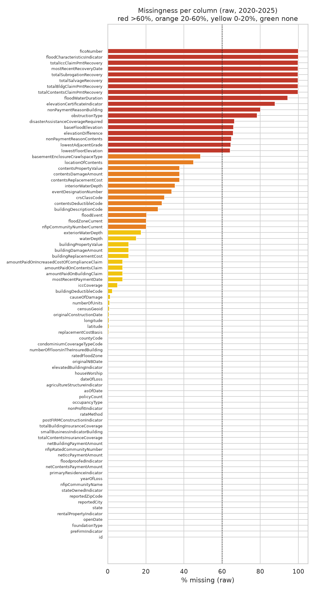

### 2.2 Distributions, skew and outliers

Numeric columns with |skew| > 5 (raw): 

| column | skew | min | median | p99 | max | n_outlier_iqr3 |
|---|---|---|---|---|---|---|
| numberOfUnits | 462.01 | 0.0 | 1.00 | 41.00 | 34970.0 |  |
| contentsReplacementCost | 254.93 | -1.0 | 0.00 | 219,824.30 | 100000000.0 |  |
| netIccPaymentAmount | 217.31 | 0.0 | 0.00 | 0.00 | 900000.0 |  |
| amountPaidOnIncreasedCostOfComplianceClaim | 208.53 | 0.0 | 0.00 | 0.00 | 900000.0 |  |
| elevationDifference | -198.57 | -9980.0 | 0.00 | 9.00 | 987.0 | 275.00 |
| contentsPropertyValue | 126.71 | -1.0 | 40,000.00 | 915,508.54 | 250000000.0 | 6,863.00 |
| buildingReplacementCost | 100.70 | 0.0 | 266,230.00 | 9,906,103 | 1673931037.0 | 17,185.00 |
| buildingDamageAmount | 95.78 | 0.0 | 26,926.00 | 523,352.20 | 52840990.0 | 4,753.00 |
| lowestAdjacentGrade | -84.29 | -99999.9 | 6.00 | 1,822.49 | 9998.9 | 14,101.00 |
| contentsDamageAmount | 57.72 | 0.0 | 2,029.00 | 129,398.46 | 16741290.0 | 8,155.00 |
| buildingPropertyValue | 48.46 | 0.0 | 204,166.00 | 7,388,195 | 526308898.0 | 16,829.00 |
| totalBuildingInsuranceCoverage | 38.36 | 0.0 | 250,000.00 | 5,000,000 | 272500000.0 | 24,054.00 |
| policyCount | 35.36 | 1 | 1.00 | 22.00 | 1090 |  |
| floodWaterDuration | 26.31 | 0.0 | 0.00 | 5.00 | 127.0 |  |
| exteriorWaterDepth | 21.20 | -239.0 | 15.00 | 999.00 | 9600.0 | 5,780.00 |
| disasterAssistanceCoverageRequired | 18.74 | 0.0 | 0.00 | 0.00 | 5.0 |  |
| netBuildingPaymentAmount | 18.46 | -2250000.0 | 18,256.73 | 488,475.75 | 10741476.93 | 4,548.00 |
| amountPaidOnBuildingClaim | 18.03 | -2250000.0 | 23,908.38 | 500,000.00 | 10741476.93 | 4,307.00 |
| totalSubrogationRecovery | 16.98 | 0.0 | 0.00 | 0.00 | 6209.69 |  |
| totalIccClaimPmtRecovery | 15.96 | 0.0 | 0.00 | 0.00 | 12000.0 |  |
| lowestFloorElevation | 13.28 | -9999.0 | 9.90 | 1,993.00 | 9998.9 | 11,851.00 |
| totalBldgClaimPmtRecovery | 9.93 | 0.0 | 7,500.00 | 199,586.57 | 1000000.0 | 21.00 |
| netContentsPaymentAmount | 9.21 | -80000.0 | 0.00 | 100,000.00 | 757048.95 | 39,408.00 |
| amountPaidOnContentsClaim | 8.89 | -80000.0 | 0.00 | 100,000.00 | 757048.95 | 30,548.00 |
| baseFloodElevation | 8.43 | -13.8 | 9.00 | 9,990.00 | 9990.0 | 13,622.00 |
| totalContentsClaimPmtRecovery | 8.31 | 0.0 | 0.00 | 27,487.28 | 100000.0 |  |
| interiorWaterDepth | 6.95 | -296.0 | 2.00 | 999.00 | 1380.0 | 14,494.00 |
| totalSalvageRecovery | 5.29 | 0.0 | 0.00 | 74,635.36 | 102265.27 |  |

Money fields are extremely right-skewed with absurd tails (e.g. `buildingReplacementCost` max $1,673,931,037, `totalBuildingInsuranceCoverage` max $272,500,000, `amountPaidOnBuildingClaim` max $10,741,477, `buildingDamageAmount` max $52,840,990). The median gross building payment (rows with a payment record) is $23,908; the 99th percentile is $500,000; 2.2% of positive building payments equal exactly $250,000 and 0.5% exactly $500,000 (policy limits), and 2.9% of positive contents payments equal $100,000.

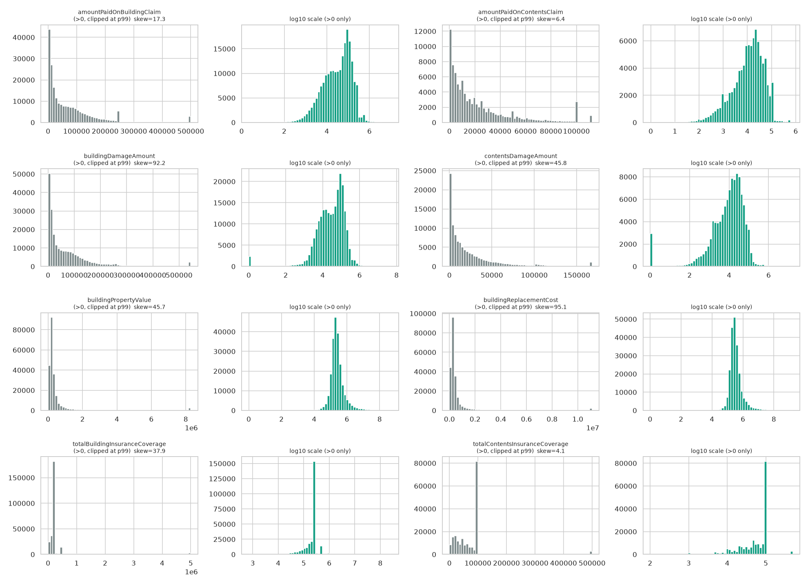

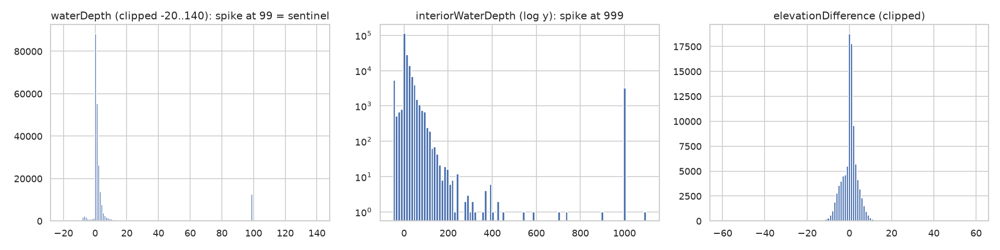

### 2.3 Logical consistency / impossible values (raw)

| check | count / pct |
|---|---|
| construction_date_before_1850 | 395 |
| construction_date_after_loss | 90 |
| construction_date_is_Jan1_pct | 55.1 |
| policy_start_after_loss_date | 6,339 |
| policy_start_before_1970 | 50 |
| openDate_before_loss | 56 |
| openDate_gt_365d_after_loss | 997 |
| paymentDate_before_openDate | 343 |
| paid_building_negative | 35 |
| paid_contents_negative | 18 |
| paid_building_null_but_net_building_zero_pct | 100.0 |
| waterDepth_eq_99_count (sentinel suspect) | 12,509 |
| waterDepth_negative | 12,428 |
| interiorWaterDepth_eq_999 | 3,189 |
| exteriorWaterDepth_ge_999 | 2,912 |
| baseFloodElevation_ge_9990 | 966 |
| lowestFloorElevation_abs_ge_9990 | 139 |
| lowestAdjacentGrade_abs_ge_9990 | 42 |
| elevationDifference_abs_ge_500 | 13 |
| buildingPropertyValue_zero | 27,847 |
| buildingReplacementCost_zero | 27,415 |
| building_damage_zero | 25,170 |
| net_bldg_payment_gt_coverage | 639 |
| net_bldg_payment_gt_damage | 52,703 |
| preFirm_and_postFirm_both_true | 220 |
| preFirm_and_postFirm_both_false | 118,485 |
| contents_cov_zero_and_contentsDeductible_null_pct | 97.3 |
| contents_cov_zero_and_contentsDamage_null_pct | 76.5 |
| zip_code_len_not_5 | 258 |
| state_blank | 1 |

Notes: negative `amountPaid*` values are re-issued checks (35 building, 18 contents rows). 52,703 rows pay more than the recorded `buildingDamageAmount` (damage is an ACV estimate for the *main* building and payments may include other items, so this is not necessarily an error). `preFirmIndicator` and `postFIRMConstructionIndicator` are not complements (118,485 rows are False/False), so `preFirmIndicator` is treated as redundant/ambiguous.

### 2.4 Dates, duplicates, per-year counts and the 2025 'reporting lag'

Date ranges (raw): `dateOfLoss` 2020-01-01 to 2025-12-31; `originalConstructionDate` 1069-01-01 to 2026-03-17; `originalNBDate` 0998-09-21 to 2026-10-20; `openDate` 2020-01-02 to 2026-09-04; `mostRecentRecoveryDate` 2020-06-10 to 2026-09-02; `mostRecentPaymentDate` 1900-01-01 to 2026-09-08.

Duplicates: no duplicate `id`; 453 extra copies (0.16%) of rows that are identical in every column except `id`. 48% of the duplicated rows are condominium association/master policies and 9% have a positive building payment, so a minority may be genuine separate units; they were dropped (documented, negligible impact).

| year | n_claims | % claims paid | mean_total_paid | median_total_paid | total_paid_usd | % bldg damage missing | % of rows |
|---|---|---|---|---|---|---|---|
| 2020 | 33,185 | 74.0 | 28,106.6 | 7,212.8 | 932,716,073 | 13.2 | 12.0 |
| 2021 | 46,699 | 75.8 | 41,894.5 | 13,442.8 | 1,956,429,806 | 9.5 | 16.9 |
| 2022 | 60,262 | 78.1 | 87,204.3 | 27,489.8 | 5,255,102,897 | 13.3 | 21.8 |
| 2023 | 21,690 | 76.6 | 45,171.2 | 16,896.2 | 979,763,510 | 12.7 | 7.8 |
| 2024 | 102,054 | 83.9 | 86,255.3 | 44,000.0 | 8,802,703,316 | 9.5 | 36.8 |
| 2025 | 13,143 | 80.7 | 47,787.0 | 19,921.7 | 628,064,988 | 9.8 | 4.7 |

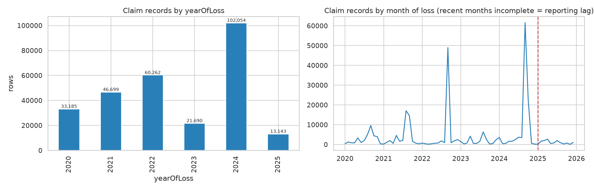

**2025 caveat.** 2025 has only 13,143 claims. Median monthly claim count by loss year: 2020: 1,646, 2021: 1,645, 2022: 854, 2023: 1,141, 2024: 2,095, 2025: 880; the yearly totals are driven by a few catastrophe months (Ida 2021, Ian 2022, Helene/Milton 2024). The largest named event of 2025 has 2,068 claims (Central U.S. April Flooding); 6,804 of the 13,143 2025 claims have no named event. The `openDate - dateOfLoss` lag has median 3 d, p90 25 d, p95 50 d, p99 201 d against a snapshot dated 2026-09-08, so a small share of late-2025 claims (and open/unpaid ones: 81% of 2025 claims are paid vs 84% for 2024) may still be missing or revised. The data alone cannot separate 'quiet year' from 'incomplete reporting': the 2025 median month is in line with 2022, which points to a quiet year as the main reason, but treat 2025 as provisional and do not read the count as a trend.

Risk Rating 2.0 share (`rateMethod == 'RE'`) by year of loss: 2020: 63%, 2021: 75%, 2022: 96%, 2023: 99%, 2024: 99%, 2025: 98%. The rating-system shift is a built-in structural change inside the window; `is_rr2` is therefore kept as a feature.

Most frequent flood events (cleaned data): Hurricane Helene (58,019), Hurricane Ian (48,638), Hurricane Ida (28,273), Hurricane Milton (21,598), Hurricane Sally (8,109), Hurricane Idalia (5,520), Hurricane Eta (3,677), April Florida Flooding (3,440). Building non-payment reasons (when building not paid, top codes):

| code | meaning | claims |
|---|---|---|
| 06 | Not actual flood | 12,493 |
| 99 | Erroneous assignment | 12,229 |
| 01 | Claim denied, less than deductible | 10,653 |
| 97 | Other | 8,206 |
| 20 | No demonstrable damage | 6,320 |
| 98 | Error-delete claim | 2,654 |
| 08 | Failure to pursue claim | 1,173 |
| 16 | Not insured, wind damage | 323 |

## 3. Column guide and keep / drop decisions (all 84 raw columns)

Full table with descriptions from the OpenFEMA data dictionary: **`column_dictionary.csv`** (column, description, dtype, missing %, n_unique, decision, reason, role, derived features). Roles: *feature*, *target-component*, *leakage* (post-outcome), *id*, *geo-key*, *split-key*, *dropped*. Engineered features: `engineered_feature_dictionary.csv`.

Decision counts: drop = 42, keep = 26, maybe = 16. By role: feature = 37, dropped = 25, leakage = 13, geo-key = 4, split-key = 2, target-component = 2, id = 1.

### 3.1 Decision = keep (26 columns)

| column | missing_pct | n_unique | role | reason |
|---|---|---|---|---|
| basementEnclosureCrawlspaceType | 48.7 | 4 | feature | structure/exposure info; 48.7% missing -> kept as explicit 'unknown' category (missing is not random) |
| policyCount | 0.0 | 258 | feature | insured units on the record (RCBAP condos >1); extremely right-skewed -> clipped + log1p |
| crsClassCode | 29.8 | 10 | feature | community CRS class (1-10); 29.8% missing -> 'unknown' category + ordinal |
| dateOfLoss | 0.0 | 2,176 | split-key | time key; used for split and for seasonality features (month sin/cos), not as raw date |
| elevatedBuildingIndicator | 0.0 | 2 | feature | building elevated per NFIP definition; no missing |
| ratedFloodZone | 0.0 | 52 | feature | FIRM zone used to rate policy; 52 raw labels collapsed to zone families (AE, A, AH, AO, A99, V, X, D) |
| locationOfContents | 45.0 | 7 | feature | where contents sit (basement/lowest floor..); 45% missing -> 'unknown' category |
| numberOfFloorsInTheInsuredBuilding | 0.1 | 6 | feature | building height code; 0.12% missing -> mode |
| occupancyType | 0.0 | 14 | feature | occupancy code; legacy 1-digit codes harmonised to Risk Rating 2.0 2-digit codes |
| originalConstructionDate | 0.7 | 17,411 | feature | converted to building age at loss; invalid dates (<1850, after loss) set missing; 55% are Jan-1 placeholders |
| originalNBDate | 0.0 | 13,121 | feature | converted to policy tenure at loss; dates after loss / before 1968 invalid -> missing |
| amountPaidOnBuildingClaim | 7.8 | 195,669 | target-component | TARGET COMPONENT (gross building payment); NaN (7.8%) means claim closed with no payment (net payment is 0 in 100% of those rows) -> 0 |
| amountPaidOnContentsClaim | 7.8 | 71,148 | target-component | TARGET COMPONENT (gross contents payment); NaN -> 0 as above |
| postFIRMConstructionIndicator | 0.0 | 2 | feature | built after FIRM / 1974 (rating & code-compliance proxy); no missing |
| rateMethod | 0.0 | 15 | feature | rating method; 'RE' = Risk Rating 2.0 (90% of rows); collapsed to 6 groups |
| totalBuildingInsuranceCoverage | 0.0 | 4,138 | feature | policy building limit (0 = contents-only policy); skewed -> clip p99.9 + log1p; flag no_building_cov |
| totalContentsInsuranceCoverage | 0.0 | 1,175 | feature | policy contents limit (0 = no contents cover); log1p; flag no_contents_cov |
| yearOfLoss | 0.0 | 6 | split-key | identical to year(dateOfLoss); used as split/grouping key only (a trend variable would not generalise) |
| primaryResidenceIndicator | 0.0 | 2 | feature | primary residence flag; no missing |
| buildingDeductibleCode | 2.5 | 14 | feature | deductible code mapped to USD; 2.4% missing -> 'unknown' flag + mode |
| causeOfDamage | 1.3 | 12 | feature | TIER B: recorded at adjustment; codes grouped (rainfall, tidal, stream/river, other, expedited, unknown) |
| condominiumCoverageTypeCode | 0.1 | 5 | feature | condo coverage type (N/U/A/L/H); 0.13% missing -> mode |
| rentalPropertyIndicator | 0.0 | 2 | feature | rental flag; 7.5% True |
| state | 0.0 | 56 | feature | two-letter state; rare states grouped to 'OTHER' for ML (top 15 kept) |
| foundationType | 0.0 | 7 | feature | foundation code (0 is undocumented -> 'unknown'); no missing |
| openDate | 0.0 | 2,279 | feature | claim open date; used for report_lag_days (open - loss), known early in the claim life-cycle |

### 3.2 Decision = maybe (16 columns)

| column | missing_pct | n_unique | role | reason |
|---|---|---|---|---|
| smallBusinessIndicatorBuilding | 0.0 | 2 | feature | 97.3% False - weak but non-trivial; kept as binary |
| buildingDamageAmount | 11.0 | 114,064 | feature | TIER B: adjuster-assessed ACV damage; strongest driver of payout but only known after inspection (leakage if the goal is early triage); 0 is valid, 11% NaN |
| buildingPropertyValue | 11.0 | 169,043 | feature | TIER B: adjuster-estimated ACV of building; 0 (impossible when coverage>0) treated as missing; heavy tail (max 5e8) |
| contentsDamageAmount | 37.8 | 47,609 | feature | TIER B: adjuster-assessed contents damage; 37.8% NaN, most of it structural (no contents cover -> set to 0); the rest is 'not inspected' -> flag + impute |
| contentsDeductibleCode | 28.5 | 14 | feature | contents deductible USD; 97% of NaN are structural (no contents coverage) -> 0; redundant with no_contents_cov for most rows |
| contentsPropertyValue | 37.8 | 36,824 | feature | TIER B: adjuster-estimated contents value; 37.8% NaN, extreme outliers (max 2.5e8) |
| floodEvent | 20.4 | 68 | geo-key | named catastrophe (20% missing = no named event). Informative but event-specific: only binary named_event is a feature; the name is a grouping key for event-level CV |
| numberOfUnits | 1.0 | 340 | feature | units under condo master policy; max 34,970 -> clipped at p99.9; mostly 0/1 so weak |
| buildingReplacementCost | 11.0 | 175,285 | feature | TIER B: insurer-estimated replacement cost; strongly collinear with buildingPropertyValue; 0 -> missing |
| replacementCostBasis | 0.6 | 2 | feature | TIER B: dictionary describes it as the basis on which the building CLAIM WAS SETTLED (R=replacement cost, A=actual cash value) -> adjustment-stage field; claims with R are paid 91% vs 75% for A and 21% when missing (0.6% of rows, mode-filled) |
| waterDepth | 15.1 | 260 | feature | TIER B: adjuster-recorded depth (inches); 15% missing; value 99 is a sentinel (12,509 rows) -> NaN; negatives retained (they carry signal) |
| buildingDescriptionCode | 26.4 | 18 | feature | building use (main house/apartment/other); 26% missing -> 'unknown' category; rare levels grouped |
| latitude | 0.7 | 298 | feature | rounded to 0.1 deg (~11 km); 0.66% missing -> county/state median; collinear with state |
| longitude | 0.7 | 619 | feature | rounded to 0.1 deg (~11 km); 0.66% missing -> county/state median; collinear with state |
| exteriorWaterDepth | 17.6 | 438 | feature | TIER B: exterior water mark (in); 17.6% missing; >=999 sentinel/implausible -> NaN |
| interiorWaterDepth | 35.3 | 380 | feature | TIER B: interior water mark (in); 35% missing; 999 sentinel -> NaN |

### 3.3 Decision = drop (42 columns)

| column | missing_pct | n_unique | role | reason |
|---|---|---|---|---|
| agricultureStructureIndicator | 0.0 | 2 | dropped | near-constant (99.97% False) |
| asOfDate | 0.0 | 1 | dropped | constant (single snapshot timestamp 2026-09-08) |
| elevationCertificateIndicator | 87.7 | 9 | dropped | 87.7% missing (>60%); availability kept as flag |
| elevationDifference | 65.8 | 107 | dropped | 65.8% missing (>60%), outliers/sentinels (e.g. -9980, 987); availability kept as flag |
| baseFloodElevation | 66.0 | 4,535 | dropped | 66.0% missing (>60%), sentinel 9990, absolute elevation acts as a location proxy |
| houseWorship | 0.0 | 2 | dropped | near-constant (99.89% False) |
| lowestAdjacentGrade | 64.5 | 6,068 | dropped | 64.5% missing (>60%), sentinels (+/-9999), absolute elevation = location proxy |
| lowestFloorElevation | 64.2 | 6,054 | dropped | 64.2% missing (>60%), sentinels (+/-9999), absolute elevation = location proxy |
| nonProfitIndicator | 0.0 | 2 | dropped | near-constant (99.2% False) |
| obstructionType | 78.4 | 19 | dropped | 78.4% missing (>60%); only defined for elevated buildings |
| amountPaidOnIncreasedCostOfComplianceClaim | 7.8 | 449 | leakage | 99.6% zeros; payment (post-outcome) - not a feature; kept only as paid_icc for reference |
| netBuildingPaymentAmount | 0.0 | 195,650 | leakage | LEAKAGE: = amountPaidOnBuildingClaim minus recoveries (post-outcome); kept in file only for reference |
| netContentsPaymentAmount | 0.0 | 71,140 | leakage | LEAKAGE: net contents payment (post-outcome) |
| disasterAssistanceCoverageRequired | 66.5 | 5 | dropped | 66.5% missing (>60%) and 99.4% of non-missing are 0 |
| eventDesignationNumber | 33.5 | 67 | dropped | redundant with floodEvent (EDN replaced FICO in 2020), ID-like, 33.5% missing |
| ficoNumber | 100.0 | 0 | dropped | 100% null (replaced by eventDesignationNumber in 2020) |
| floodCharacteristicsIndicator | 100.0 | 0 | dropped | 100% null |
| floodWaterDuration | 94.4 | 38 | dropped | 94.4% missing (>60%) |
| floodproofedIndicator | 0.0 | 2 | dropped | constant (100% False) |
| iccCoverage | 5.1 | 1 | dropped | constant (30000 for all non-missing rows) |
| netIccPaymentAmount | 0.0 | 450 | leakage | LEAKAGE + near-constant (99.6% zeros) |
| nfipRatedCommunityNumber | 0.0 | 7,884 | dropped | ID-like, 7.9k levels |
| nfipCommunityNumberCurrent | 20.2 | 7,293 | dropped | ID-like, 7.3k levels, 20% missing, redundant with rated community |
| nfipCommunityName | 0.0 | 6,775 | dropped | free-text-like name, 6.8k levels, duplicate of community number |
| nonPaymentReasonContents | 64.9 | 23 | leakage | LEAKAGE: reason a claim was closed without payment (post-outcome); useful only for descriptive analysis; 64.9% missing |
| nonPaymentReasonBuilding | 80.2 | 23 | leakage | LEAKAGE: reason a claim was closed without payment (post-outcome); 80.2% missing |
| contentsReplacementCost | 37.8 | 6,316 | dropped | redundant with contentsPropertyValue/coverage; 37.8% missing; extreme skew |
| stateOwnedIndicator | 0.0 | 2 | dropped | near-constant (99.97% False) |
| floodZoneCurrent | 20.2 | 51 | dropped | 20% missing; redundant with ratedFloodZone (74% identical); reflects later map revisions |
| reportedCity | 0.0 | 1 | dropped | constant ('Currently Unavailable') |
| reportedZipCode | 0.0 | 11,898 | geo-key | high cardinality (11.9k levels) / quasi-identifier; retained as geo key for joins only |
| countyCode | 0.2 | 2,235 | geo-key | high cardinality (2.2k levels); retained as geo key (also used to fill lat/lon) |
| censusGeoid | 0.9 | 39,628 | geo-key | block-group id (39.6k levels), join key to ACS/Census; not a model feature |
| mostRecentRecoveryDate | 99.8 | 274 | leakage | 99.85% missing; post-outcome |
| mostRecentPaymentDate | 7.8 | 2,317 | leakage | LEAKAGE: payment date is post-outcome (null exactly when no payment); 1900-01-01 placeholders |
| preFirmIndicator | 0.0 | 2 | dropped | ambiguous/redundant with postFIRMConstructionIndicator (both False for 118k rows, both True for 220) and building_age |
| totalSalvageRecovery | 99.8 | 33 | leakage | 99.85% missing; post-outcome |
| totalBldgClaimPmtRecovery | 99.8 | 219 | leakage | 99.85% missing; post-outcome |
| totalContentsClaimPmtRecovery | 99.8 | 53 | leakage | 99.85% missing; post-outcome |
| totalIccClaimPmtRecovery | 99.8 | 3 | leakage | 99.85% missing; post-outcome |
| totalSubrogationRecovery | 99.8 | 3 | leakage | 99.85% missing; post-outcome |
| id | 0.0 | 277,033 | id | unique row identifier (kept as key only) |

### 3.4 Unused / dropped columns grouped by reason

| reason | n | columns |
|---|---|---|
| leakage / post-outcome | 13 | amountPaidOnIncreasedCostOfComplianceClaim, netBuildingPaymentAmount, netContentsPaymentAmount, netIccPaymentAmount, nonPaymentReasonContents, nonPaymentReasonBuilding, mostRecentRecoveryDate, mostRecentPaymentDate, totalSalvageRecovery, totalBldgClaimPmtRecovery, totalContentsClaimPmtRecovery, totalIccClaimPmtRecovery, totalSubrogationRecovery |
| too much missing (>60%) | 8 | elevationCertificateIndicator, elevationDifference, baseFloodElevation, lowestAdjacentGrade, lowestFloorElevation, obstructionType, disasterAssistanceCoverageRequired, floodWaterDuration |
| redundant / duplicate of another column | 6 | eventDesignationNumber, nfipCommunityNumberCurrent, nfipCommunityName, contentsReplacementCost, floodZoneCurrent, preFirmIndicator |
| near-constant | 4 | agricultureStructureIndicator, houseWorship, nonProfitIndicator, stateOwnedIndicator |
| constant | 4 | asOfDate, floodproofedIndicator, iccCoverage, reportedCity |
| ID-like / high cardinality | 4 | nfipRatedCommunityNumber, reportedZipCode, countyCode, censusGeoid |
| all-null | 2 | ficoNumber, floodCharacteristicsIndicator |
| identifier | 1 | id |

## 4. Cleaning

Script: `scripts/03_clean_impute.py`. Every step and the number of rows affected is in `outputs/cleaning_log.csv`:

| step | description | rows |
|---|---|---|
| dedupe | exact duplicate rows (all columns except surrogate id) dropped, first copy kept | 453 |
| types | Decimal columns -> float64, date objects -> datetime64, bool -> int8 | 0 |
| types | blank state set to missing | 1 |
| types | ZIP codes whose length != 5 (kept as-is, not used as a feature) | 258 |
| payments | amountPaid* NaN (claim closed w/o payment; net payment==0 in all of them) -> 0 | 21,568 |
| payments | negative building payments (re-issued checks) clipped to 0 in target | 35 |
| payments | negative contents payments clipped to 0 in target | 18 |
| payments | high_severity threshold = 90th pct of paid claims in training years = $174,530; positives | 28,300 |
| payments | building payment exceeds building coverage by more than $1 (flag only: kept, may include ICC/limit adjustments) | 665 |
| dates | originalConstructionDate < 1850 or after loss -> NaT | 485 |
| dates | originalNBDate after loss or before 1968 (NFIP start) -> NaT | 6,371 |
| dates | report lag (openDate - dateOfLoss) negative -> NaN | 56 |
| dates | report lag > 365 days winsorised to 365 | 994 |
| categorical | legacy 1-digit occupancyType codes harmonised to 2-digit (1->11,2->12,3->13,4/6->18) | 26,164 |
| categorical | ratedFloodZone 52 labels -> zone families | 276,527 |
| impute-mode | condominiumCoverageTypeCode missing -> mode | 347 |
| impute-mode | replacementCostBasis missing -> mode | 1,613 |
| impute-mode | numberOfFloorsInTheInsuredBuilding missing -> mode (1) | 346 |
| zero-vs-missing | contentsDeductibleCode NaN where contents coverage==0 -> 0 (no contents deductible applies) | 78,604 |
| winsorise | totalBuildingInsuranceCoverage clipped at p99.9 ($28,855,250) before log1p | 277 |
| winsorise | totalContentsInsuranceCoverage clipped at p99.9 ($500,000) before log1p | 0 |
| winsorise | policyCount clipped at p99.9 | 275 |
| impute-median | numberOfUnits missing -> median | 2,718 |
| zero-vs-missing | buildingPropertyValue == 0 with building coverage > 0 (impossible) -> NaN | 26,637 |
| zero-vs-missing | buildingReplacementCost == 0 with building coverage > 0 (impossible) -> NaN | 26,207 |
| zero-vs-missing | buildingPropertyValue/ReplacementCost == 0 with NO building coverage kept as 0 (contents-only policies) | 1,074 |
| zero-vs-missing | contentsPropertyValue == -1 (invalid) -> NaN | 1 |
| zero-vs-missing | contentsDamageAmount NaN where contents coverage==0 -> 0 (structural) | 61,757 |
| zero-vs-missing | contentsPropertyValue NaN where contents coverage==0 -> 0 (structural) | 61,757 |
| sentinel | waterDepth == 99 (sentinel spike; claims at 99 behave like 'unknown', not like 98/100) -> NaN | 12,489 |
| info | waterDepth < 0 RETAINED (88% of those claims are paid vs 69% at depth 0 and 55% when depth is missing: carries signal) | 12,428 |
| sentinel | interiorWaterDepth >= 999 (sentinel) -> NaN | 3,190 |
| sentinel | exteriorWaterDepth >= 999 (sentinel/implausible) -> NaN | 2,912 |
| info | interior/exterior depth negatives retained (relative to lowest adjacent grade); all three depths winsorised at p1/p99.5 | 7,970 |
| sentinel | elevation columns with sentinel/implausible values (dropped columns; flagged only) | 1,001 |
| flag | adjuster_info_missing (building damage/value/replacement cost missing) | 30,343 |
| flag | building value or replacement cost missing although damage is present (zero->NaN recode; value-valuation not recorded) | 26,880 |
| winsorise | buildingDamageAmount clipped at p99.9 ($1,850,850) then log1p | 247 |
| winsorise | buildingPropertyValue clipped at p99.9 ($53,075,765) then log1p | 220 |
| winsorise | buildingReplacementCost clipped at p99.9 ($69,424,260) then log1p | 221 |
| winsorise | contentsDamageAmount clipped at p99.9 ($603,915) then log1p | 235 |
| winsorise | contentsPropertyValue clipped at p99.9 ($4,087,512) then log1p | 235 |
| save | cleaned_claims.csv size 159 MB; rows | 276,580 |

**Design choices**

- *Dedupe*: exact duplicates ignoring the surrogate `id`; first copy kept.
- *Null payment = 0*: `amountPaid*` is null exactly when the claim was closed without payment (net payment 0, no payment date). Filling 0 is a recode, not an imputation. Negative payments (re-issued checks) clipped to 0 in the target; gross payments (not net of recoveries) are used so the target matches the requested definition `total_paid = amountPaidOnBuildingClaim + amountPaidOnContentsClaim`.
- *Zero vs missing*: zero building property value / replacement cost with building coverage > 0 is impossible and is treated as missing (these are claims with no valuation: 49% paid vs 83% otherwise). Zero damage is kept as a real value (0 damage = typically denied claims, 15% paid). Contents damage/value/deductible that are null only because the policy has no contents coverage are set to 0.
- *Sentinels*: waterDepth 99 (spike: claims at 99 behave like 'unknown', 64.0% paid vs 100.0% at depth 98 and 100.0% at 100), interior depth 999, exterior depth >= 999, elevation fields >= 9990 / abs >= 500. Negative `waterDepth` is kept (88% paid vs 68% at depth 0 and 54% when depth is missing, so it carries information); depths are winsorised at p1/p99.5.
- *Standardisation*: legacy 1-digit occupancy codes mapped to 2-digit Risk Rating 2.0 codes; 52 flood-zone labels -> 8 zone families (A01-A30 = AE); `rateMethod` -> 7 groups; deductible codes -> USD; cause of damage -> 6 groups; foundation/basement/contents-location codes labelled; rare states -> 'OTHER'.
- *Skew*: money inputs clipped at their 99.9th percentile then `log1p`; the target is modelled as `log1p(total_paid)`; table below (observed values only):

| column | skew_raw | transformed | skew_after | max_raw | max_after_expm1 |
|---|---|---|---|---|---|
| totalBuildingInsuranceCoverage | 38.35 | log_bldg_coverage | -4.78 | 272,500,000 | 28,855,250 |
| totalContentsInsuranceCoverage | 3.61 | log_cont_coverage | -0.84 | 500,000.00 | 500,000.00 |
| buildingDamageAmount | 95.77 | log_bldg_damage | -1.80 | 52,840,990 | 1,850,850 |
| buildingPropertyValue | 48.44 | log_bldg_value | -3.72 | 526,308,898 | 53,075,765 |
| buildingReplacementCost | 100.65 | log_repl_cost | -4.07 | 1,673,931,037 | 69,424,260 |
| contentsDamageAmount | 57.70 | log_cont_damage | 0.38 | 16,741,290 | 603,915.44 |
| contentsPropertyValue | 126.67 | log_cont_value | 0.23 | 250,000,000 | 4,087,512 |
| policyCount | 35.35 | log_policy_count | 6.35 | 1,090.00 | 125.00 |
| total_paid (target) | 16.13 | log_total_paid | -1.13 | 10,841,477 | 10,841,477 |
| total_paid / paid>0 | 15.36 | log1p | -0.53 | 10,841,477 | 10,841,477 |

Note the log of the coverage/value fields becomes *left*-skewed because of the zeros and a few tiny values; skew is much closer to 0 for the damage and target columns. Tree models are invariant to the transform; it matters for linear/KNN/clustering.

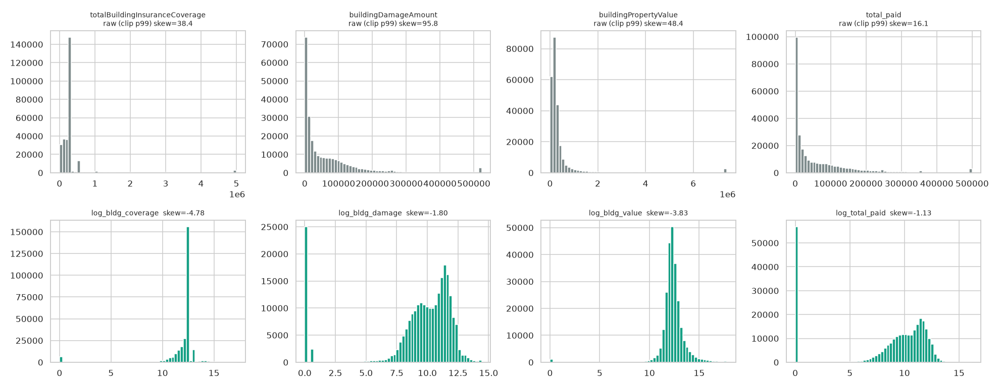

## 5. Imputation

Rules: do not impute where missingness is structural (recode instead), do not impute categorical 'unknown' where the absence is itself informative, flag every imputed numeric field, drop (not impute) columns with >60% missing. **All imputers are fit on the training period (yearOfLoss <= 2023) only** and applied to every row, so the 2024-25 test period does not influence any imputation parameter. Imputation log: `outputs/imputation_log.csv`.

| column | n_imputed | pct_imputed | strategy | justification |
|---|---|---|---|---|
| latitude | 1,826 | 0.66 | group-wise median (county -> state -> global) | coordinates are rounded to 0.1deg; location missingness is tiny and geography is the dominant structure |
| longitude | 1,826 | 0.66 | group-wise median (county -> state -> global) | coordinates are rounded to 0.1deg; location missingness is tiny and geography is the dominant structure |
| building_age | 2,447 | 0.88 | group-wise median (occupancy x state group), fallback global median | dates invalid/missing in <3% of rows; age/tenure differ strongly by occupancy and region |
| policy_tenure_years | 6,422 | 2.32 | group-wise median (occupancy x state group), fallback global median | dates invalid/missing in <3% of rows; age/tenure differ strongly by occupancy and region |
| crs_class | 82,372 | 29.78 | group-wise median by state + crs_unknown flag | 29.8% missing, but missingness itself is kept as a flag (crs_unknown); numeric value only for tree/linear convenience |
| report_lag_days | 56 | 0.02 | global median | only 56 invalid rows |
| bldg_deductible_usd | 6,753 | 2.44 | mode + bldg_deductible_missing flag | 2.4% missing, categorical-like with a dominant level; flag preserves missingness |
| cont_deductible_usd | 7 | 0.00 | structural 0 where no contents coverage (done in cleaning); remaining NaN -> mode | 97% of NaNs are 'no contents coverage' |
| contents_location / basement_type / building_use | 0 | 0.00 | explicit 'unknown' category | 45% / 49% / 26% missing and not random (relates to rating system & occupancy); imputing a category would invent information |
| log_bldg_damage | 30,343 | 10.97 | KNN(k=10) (chosen by joint-masking validation) + missing flag; fit on 2020-23 sample of 40k; values clipped to observed range | adjuster-block values are missing together, so the method was chosen on the JOINT-masking experiment; flag retained because missingness is informative |
| log_bldg_value | 56,980 | 20.60 | KNN(k=10) (chosen by joint-masking validation) + missing flag; fit on 2020-23 sample of 40k; values clipped to observed range | adjuster-block values are missing together, so the method was chosen on the JOINT-masking experiment; flag retained because missingness is informative |
| log_repl_cost | 56,550 | 20.45 | KNN(k=10) (chosen by joint-masking validation) + missing flag; fit on 2020-23 sample of 40k; values clipped to observed range | adjuster-block values are missing together, so the method was chosen on the JOINT-masking experiment; flag retained because missingness is informative |
| log_cont_damage | 42,486 | 15.36 | KNN(k=10) (chosen by joint-masking validation) + missing flag; fit on 2020-23 sample of 40k; values clipped to observed range | adjuster-block values are missing together, so the method was chosen on the JOINT-masking experiment; flag retained because missingness is informative |
| log_cont_value | 42,487 | 15.36 | Iterative(BayesianRidge) (chosen by joint-masking validation) + missing flag; fit on 2020-23 sample of 40k; values clipped to observed range | adjuster-block values are missing together, so the method was chosen on the JOINT-masking experiment; flag retained because missingness is informative |
| water_depth | 53,998 | 19.52 | Iterative(BayesianRidge) (chosen by joint-masking validation) + missing flag; fit on 2020-23 sample of 40k; values clipped to observed range | adjuster-block values are missing together, so the method was chosen on the JOINT-masking experiment; flag retained because missingness is informative |
| interior_depth | 100,507 | 36.34 | Iterative(BayesianRidge) (chosen by joint-masking validation) + missing flag; fit on 2020-23 sample of 40k; values clipped to observed range | adjuster-block values are missing together, so the method was chosen on the JOINT-masking experiment; flag retained because missingness is informative |
| exterior_depth | 51,208 | 18.51 | KNN(k=10) (chosen by joint-masking validation) + missing flag; fit on 2020-23 sample of 40k; values clipped to observed range | adjuster-block values are missing together, so the method was chosen on the JOINT-masking experiment; flag retained because missingness is informative |

### 5.1 Choosing the imputer (masked-value validation)

On 20,000 fully-observed training rows, observed values were masked and re-imputed; RMSE (in the transformed units: log USD or inches) is shown. *single* = one column masked at a time; *joint* = the whole adjuster block masked together (which mimics the real missingness pattern; used to pick the method per column).

**single masking**

| column | Iterative(BayesianRidge) | KNN(k=10) | global_median | group_median(occupancy x zone) | SD of truth |
|---|---|---|---|---|---|
| exterior_depth | 18.799 | 16.122 | 24.071 | 22.827 | 23.211 |
| interior_depth | 17.397 | 13.425 | 22.548 | 22.361 | 22.146 |
| log_bldg_damage | 1.410 | 1.337 | 1.889 | 1.752 | 1.857 |
| log_bldg_value | 0.243 | 0.417 | 1.105 | 0.996 | 1.104 |
| log_cont_damage | 2.639 | 2.465 | 5.155 | 5.032 | 4.673 |
| log_cont_value | 3.288 | 2.908 | 6.854 | 6.366 | 5.716 |
| log_repl_cost | 0.210 | 0.404 | 1.043 | 0.897 | 1.032 |
| water_depth | 3.179 | 2.733 | 3.958 | 3.929 | 3.921 |

**joint masking**

| column | Iterative(BayesianRidge) | KNN(k=10) | global_median | group_median(occupancy x zone) | SD of truth |
|---|---|---|---|---|---|
| exterior_depth | 23.145 | 22.484 | 25.813 | 24.312 | 24.669 |
| interior_depth | 21.281 | 21.724 | 22.437 | 22.126 | 21.478 |
| log_bldg_damage | 1.790 | 1.750 | 2.046 | 1.866 | 1.988 |
| log_bldg_value | 0.902 | 0.794 | 1.215 | 1.108 | 1.212 |
| log_cont_damage | 3.258 | 3.244 | 5.248 | 5.078 | 4.734 |
| log_cont_value | 3.685 | 3.752 | 6.982 | 6.418 | 5.715 |
| log_repl_cost | 0.901 | 0.806 | 1.187 | 1.074 | 1.182 |
| water_depth | 3.897 | 3.991 | 4.009 | 3.977 | 3.962 |

**Joint-masking skill of the best method** (0 = no better than predicting the mean, 1 = perfect):

| column | best method | best RMSE | SD of truth | skill = 1 - RMSE/SD |
|---|---|---|---|---|
| exterior_depth | KNN(k=10) | 22.484 | 24.669 | 0.089 |
| interior_depth | Iterative(BayesianRidge) | 21.281 | 21.478 | 0.009 |
| log_bldg_damage | KNN(k=10) | 1.750 | 1.988 | 0.120 |
| log_bldg_value | KNN(k=10) | 0.794 | 1.212 | 0.345 |
| log_cont_damage | KNN(k=10) | 3.244 | 4.734 | 0.315 |
| log_cont_value | Iterative(BayesianRidge) | 3.685 | 5.715 | 0.355 |
| log_repl_cost | KNN(k=10) | 0.806 | 1.182 | 0.318 |
| water_depth | Iterative(BayesianRidge) | 3.897 | 3.962 | 0.016 |

Median baselines are clearly the worst for the value/damage/contents columns; KNN (k=10) and the iterative (MICE-style, BayesianRidge) imputer are close. When the whole adjuster block is missing together, skill is low for the depth columns (see table), i.e. depths and contents amounts are only weakly recoverable from policy/location variables. This is why the `*_missing` flags are kept and why set-A (notice-time) models are reported separately.

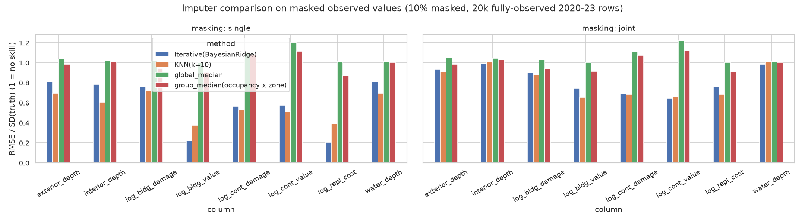

### 5.2 Before / after distributions

Statistics of *observed* vs *imputed* values (contents columns compare against observed rows with contents coverage). KS-tests are all significant because n is large and because the missingness is not random (the imputed claims are a different population: no adjuster record), so the aim is plausibility (similar scale, no collapse to a spike, no impossible values), not equality.

| column | n_observed | n_imputed | mean_observed | mean_imputed | median_observed | median_imputed | sd_observed | sd_imputed | mean_all_after | ks_stat |
|---|---|---|---|---|---|---|---|---|---|---|
| log_bldg_damage | 246,237 | 30,343 | 9.20 | 7.05 | 10.20 | 8.08 | 3.52 | 3.29 | 8.96 | 0.40 |
| log_bldg_value | 219,600 | 56,980 | 12.39 | 11.49 | 12.32 | 12.26 | 1.30 | 2.87 | 12.20 | 0.11 |
| log_repl_cost | 220,030 | 56,550 | 12.68 | 11.75 | 12.58 | 12.55 | 1.28 | 2.92 | 12.49 | 0.11 |
| log_cont_damage | 153,266 | 42,486 | 6.07 | 5.24 | 8.16 | 5.08 | 4.56 | 2.44 | 4.25 | 0.36 |
| log_cont_value | 153,265 | 42,487 | 7.61 | 7.50 | 10.82 | 7.70 | 5.40 | 1.21 | 5.50 | 0.62 |
| water_depth | 222,582 | 53,998 | 1.72 | 1.19 | 1.00 | 1.13 | 5.49 | 1.61 | 1.62 | 0.24 |
| interior_depth | 176,073 | 100,507 | 6.59 | -0.43 | 2.00 | -0.52 | 21.79 | 9.17 | 4.04 | 0.50 |
| exterior_depth | 225,372 | 51,208 | 20.46 | 12.68 | 14.00 | 9.00 | 22.28 | 12.28 | 19.02 | 0.22 |

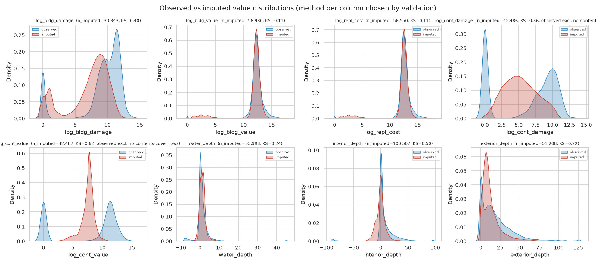

Imputed values have a smaller spread than observed ones (the usual regression-to-the-mean effect of single imputation), so downstream variance is slightly understated; use the missing flags or multiple imputation for inference. Remaining missing values in the cleaned file (not features): `nonpay_reason_building` (222,034), `nonpay_reason_contents` (179,481), `flood_event` (56,447), `countyCode` (450), `censusGeoid` (2,518).

## 6. Feature selection

### 6.1 Targets, split and feature sets

- **T1 regression**: `log_total_paid = log1p(amountPaidOnBuildingClaim + amountPaidOnContentsClaim)` on paid claims only (n train 123,590 / test 96,219); paid claims have median $42,253, mean $84,420, max $10,841,477.
- **T2 classification**: `is_paid` (total paid > 0): rate 76.5% in training years vs 83.6% in the test years.
- **T3 classification**: `high_severity` = total paid >= $174,530 (90th percentile of *paid* claims in 2020-23). Positive rate 7.7% train vs 13.9% test (2024 Helene/Milton and general claim inflation push the test period up; this is a real covariate/label shift to mention in any evaluation).
- **Time-based split**: train = loss year <= 2023 (161,546 rows), test = 2024-25 (115,034 rows). Models: XGBoost (300 trees, depth 6) and RandomForest (150 trees); categoricals ordinal-encoded.
- **Feature sets**: **A** = information known at/shortly after notice of loss (policy, property, location, rating, season, report lag); **B** = A + adjuster-assessed fields (damage, depth, value, cause of damage); **LEAK** = B + post-outcome columns (net payments, non-payment reason present) - shown only to demonstrate leakage.

### 6.2 Performance by feature set (leakage check, 2024-25 test)

| target | feature_set | model | n_features | n_test | R2 | RMSE_log | AUC | PR_AUC | base_rate |
|---|---|---|---|---|---|---|---|---|---|
| T1_reg_log_total_paid (paid claims) | A | XGBoost | 43 | 96,219 | 0.321 | 1.247 |  |  |  |
| T1_reg_log_total_paid (paid claims) | A | RandomForest | 43 | 96,219 | 0.312 | 1.254 |  |  |  |
| T1_reg_log_total_paid (paid claims) | B | XGBoost | 61 | 96,219 | 0.958 | 0.311 |  |  |  |
| T1_reg_log_total_paid (paid claims) | B | RandomForest | 61 | 96,219 | 0.946 | 0.353 |  |  |  |
| T1_reg_log_total_paid (paid claims) | LEAK | XGBoost | 65 | 96,219 | 0.998 | 0.073 |  |  |  |
| T2_cls_is_paid | A | XGBoost | 43 | 115,034 |  |  | 0.715 | 0.911 | 0.836 |
| T2_cls_is_paid | A | RandomForest | 43 | 115,034 |  |  | 0.716 | 0.913 | 0.836 |
| T2_cls_is_paid | B | XGBoost | 61 | 115,034 |  |  | 0.990 | 0.998 | 0.836 |
| T2_cls_is_paid | B | RandomForest | 61 | 115,034 |  |  | 0.989 | 0.997 | 0.836 |
| T2_cls_is_paid | LEAK | XGBoost | 65 | 115,034 |  |  | 1.000 | 1.000 | 0.836 |
| T3_cls_high_severity | A | XGBoost | 43 | 115,034 |  |  | 0.859 | 0.440 | 0.139 |
| T3_cls_high_severity | A | RandomForest | 43 | 115,034 |  |  | 0.834 | 0.382 | 0.139 |
| T3_cls_high_severity | B | XGBoost | 61 | 115,034 |  |  | 0.995 | 0.979 | 0.139 |
| T3_cls_high_severity | B | RandomForest | 61 | 115,034 |  |  | 0.993 | 0.974 | 0.139 |
| T3_cls_high_severity | LEAK | XGBoost | 65 | 115,034 |  |  | 1.000 | 1.000 | 0.139 |

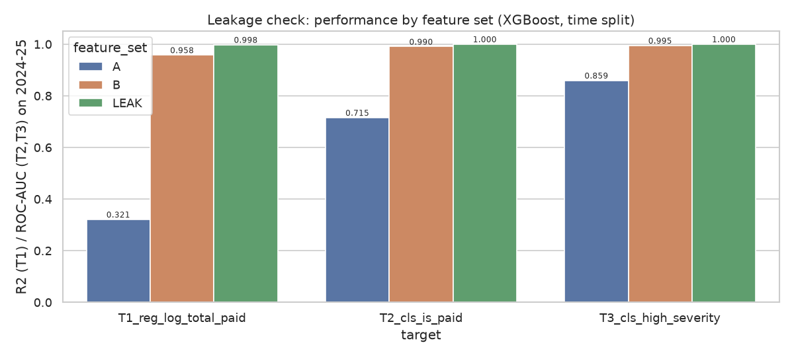

Interpretation: set A is the honest *early-triage* problem (modest skill: location, building value and coverage matter, paid/unpaid is hard to predict); set B is the *explain-the-payout-given-the-adjuster-file* problem and is dominated by damage amount; LEAK is meaningless. If a research question is about drivers of payment, use B but say so; if it is about prediction at claim notice, use A.

### 6.3 Correlation matrix

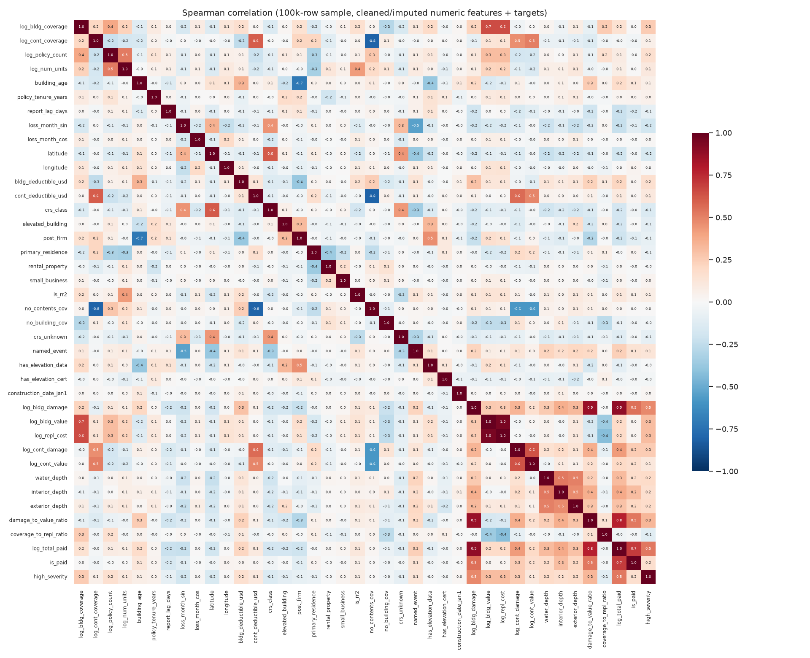

Spearman correlations (100k-row sample, imputed numeric features). Highly correlated pairs (|rho| >= 0.80) among features:

| feature_1 | feature_2 | spearman |
|---|---|---|
| log_bldg_value | log_repl_cost | 0.950 |
| log_bldg_damage | damage_to_value_ratio | 0.863 |
| cont_deductible_usd | no_contents_cov | -0.811 |
| log_cont_coverage | no_contents_cov | -0.808 |

Targets vs numeric features (Spearman; the `PAID_ONLY` column uses only paid claims):

| feature | log_total_paid | is_paid | high_severity | spearman_vs_log_total_paid_PAID_ONLY |
|---|---|---|---|---|
| log_bldg_damage | 0.883 | 0.547 | 0.484 | 0.909 |
| damage_to_value_ratio | 0.774 | 0.528 | 0.330 | 0.724 |
| log_cont_damage | 0.424 | 0.251 | 0.250 | 0.407 |
| bldg_deductible_usd | 0.211 | 0.031 | 0.161 | 0.303 |
| water_depth | 0.317 | 0.181 | 0.193 | 0.293 |
| elevated_building | -0.185 | -0.001 | -0.104 | -0.290 |
| log_bldg_value | 0.193 | 0.024 | 0.306 | 0.274 |
| log_repl_cost | 0.194 | 0.030 | 0.307 | 0.268 |
| interior_depth | 0.379 | 0.306 | 0.165 | 0.260 |
| latitude | -0.191 | -0.037 | -0.163 | -0.258 |
| crs_class | -0.184 | -0.044 | -0.148 | -0.241 |
| loss_month_sin | -0.231 | -0.114 | -0.191 | -0.239 |
| log_bldg_coverage | 0.154 | 0.004 | 0.253 | 0.239 |
| exterior_depth | 0.295 | 0.205 | 0.187 | 0.236 |
| named_event | 0.240 | 0.145 | 0.131 | 0.232 |

### 6.4 Mutual information, RF and XGBoost importances

Note: gain/impurity importance is split arbitrarily among redundant columns (e.g. the several `*_missing` flags are nearly collinear), so a high gain with a near-zero permutation drop means redundancy, not independent signal. Columns: MI (nats, 60k training sample), RF impurity importance, XGBoost total-gain share, XGBoost permutation importance (drop in R2 or AUC on the 2024-25 sample; +/- is the SD over 3 repeats) and the mean normalised rank over the four measures (`composite_rank`, 0 = best).

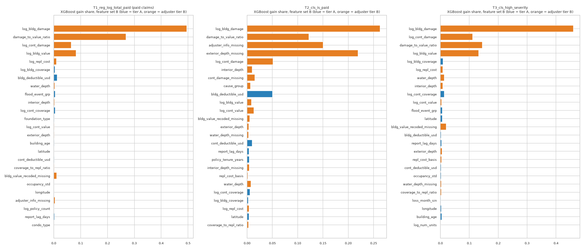

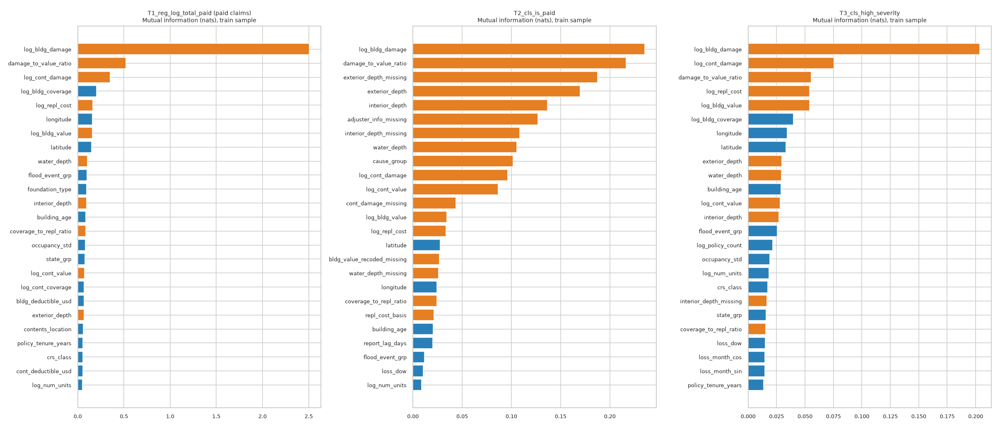

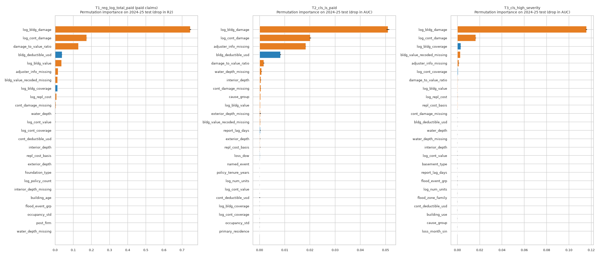

**T1 regression, feature set B: top 15**

| feature | tier | mi | rf_impurity | xgb_gain | xgb_perm_drop | xgb_perm_sd | composite_rank | recommended |
|---|---|---|---|---|---|---|---|---|
| log_bldg_damage | B | 2.5080 | 0.5869 | 0.4949 | 0.7459 | 0.0041 | 0.0164 | 1 |
| damage_to_value_ratio | B | 0.5232 | 0.1974 | 0.2685 | 0.1291 | 0.0006 | 0.0369 | 1 |
| log_cont_damage | B | 0.3506 | 0.0895 | 0.0649 | 0.1742 | 0.0007 | 0.0492 | 1 |
| log_bldg_value | B | 0.1571 | 0.0232 | 0.0833 | 0.0360 | 0.0002 | 0.0779 | 1 |
| log_repl_cost | B | 0.1626 | 0.0161 | 0.0096 | 0.0087 | 0.0002 | 0.1066 | 0 |
| log_bldg_coverage | A | 0.2012 | 0.0124 | 0.0045 | 0.0133 | 0.0001 | 0.1189 | 1 |
| bldg_deductible_usd | A | 0.0674 | 0.0079 | 0.0126 | 0.0380 | 0.0004 | 0.1516 | 1 |
| water_depth | B | 0.1057 | 0.0039 | 0.0037 | 0.0021 | 0.0001 | 0.1762 | 1 |
| flood_event_grp | A | 0.0993 | 0.0105 | 0.0057 | 0.0005 | 0.0001 | 0.1967 | 0 |
| interior_depth | B | 0.0944 | 0.0033 | 0.0031 | 0.0015 | 0.0002 | 0.2131 | 1 |
| log_cont_coverage | A | 0.0689 | 0.0028 | 0.0056 | 0.0018 | 0.0001 | 0.2172 | 1 |
| foundation_type | A | 0.0967 | 0.0026 | 0.0018 | 0.0010 | 0.0000 | 0.2459 | 1 |
| log_cont_value | B | 0.0741 | 0.0024 | 0.0017 | 0.0020 | 0.0002 | 0.2541 | 1 |
| exterior_depth | B | 0.0674 | 0.0015 | 0.0019 | 0.0010 | 0.0001 | 0.2992 | 1 |
| building_age | A | 0.0873 | 0.0010 | 0.0020 | 0.0005 | 0.0000 | 0.2992 | 1 |

**T2 paid vs unpaid, feature set B: top 15**

| feature | tier | mi | rf_impurity | xgb_gain | xgb_perm_drop | xgb_perm_sd | composite_rank | recommended |
|---|---|---|---|---|---|---|---|---|
| log_bldg_damage | B | 0.2354 | 0.2509 | 0.2627 | 0.0510 | 0.0005 | 0.0205 | 1 |
| damage_to_value_ratio | B | 0.2167 | 0.1317 | 0.1221 | 0.0017 | 0.0002 | 0.0574 | 1 |
| adjuster_info_missing | B | 0.1269 | 0.1091 | 0.1501 | 0.0184 | 0.0001 | 0.0656 | 1 |
| exterior_depth_missing | B | 0.1875 | 0.2549 | 0.2195 | 0.0003 | 0.0002 | 0.0697 | 1 |
| log_cont_damage | B | 0.0964 | 0.0551 | 0.0511 | 0.0202 | 0.0003 | 0.0902 | 1 |
| interior_depth | B | 0.1364 | 0.0154 | 0.0102 | 0.0005 | 0.0001 | 0.1230 | 1 |
| cont_damage_missing | B | 0.0438 | 0.0165 | 0.0155 | 0.0005 | 0.0000 | 0.1434 | 1 |
| cause_group | B | 0.1017 | 0.0106 | 0.0067 | 0.0004 | 0.0000 | 0.1721 | 1 |
| bldg_deductible_usd | A | 0.0087 | 0.0449 | 0.0502 | 0.0083 | 0.0002 | 0.1762 | 1 |
| log_bldg_value | B | 0.0344 | 0.0037 | 0.0084 | 0.0003 | 0.0000 | 0.2008 | 1 |
| log_cont_value | B | 0.0866 | 0.0136 | 0.0133 | 0.0001 | 0.0000 | 0.2008 | 1 |
| bldg_value_recoded_missing | B | 0.0267 | 0.0096 | 0.0051 | 0.0003 | 0.0000 | 0.2254 | 1 |
| exterior_depth | B | 0.1699 | 0.0034 | 0.0036 | 0.0002 | 0.0001 | 0.2254 | 1 |
| water_depth_missing | B | 0.0262 | 0.0012 | 0.0030 | 0.0008 | 0.0001 | 0.2869 | 1 |
| cont_deductible_usd | A | 0.0038 | 0.0086 | 0.0101 | 0.0001 | 0.0001 | 0.3320 | 0 |

**T3 high severity, feature set B: top 15**

| feature | tier | mi | rf_impurity | xgb_gain | xgb_perm_drop | xgb_perm_sd | composite_rank | recommended |
|---|---|---|---|---|---|---|---|---|
| log_bldg_damage | B | 0.2037 | 0.5680 | 0.4600 | 0.1158 | 0.0006 | 0.0164 | 1 |
| log_cont_damage | B | 0.0755 | 0.1144 | 0.1118 | 0.0165 | 0.0002 | 0.0451 | 1 |
| damage_to_value_ratio | B | 0.0554 | 0.1249 | 0.1450 | 0.0005 | 0.0001 | 0.0574 | 1 |
| log_bldg_value | B | 0.0541 | 0.0569 | 0.1325 | 0.0004 | 0.0000 | 0.0820 | 1 |
| log_bldg_coverage | A | 0.0399 | 0.0239 | 0.0093 | 0.0031 | 0.0001 | 0.0943 | 1 |
| log_repl_cost | B | 0.0542 | 0.0330 | 0.0086 | 0.0004 | 0.0001 | 0.1148 | 0 |
| water_depth | B | 0.0292 | 0.0136 | 0.0137 | 0.0003 | 0.0000 | 0.1475 | 1 |
| interior_depth | B | 0.0272 | 0.0052 | 0.0086 | 0.0002 | 0.0001 | 0.1967 | 1 |
| log_cont_coverage | A | 0.0117 | 0.0096 | 0.0131 | 0.0007 | 0.0000 | 0.2008 | 1 |
| log_cont_value | B | 0.0281 | 0.0037 | 0.0045 | 0.0002 | 0.0001 | 0.2295 | 1 |
| flood_event_grp | A | 0.0257 | 0.0022 | 0.0062 | 0.0001 | 0.0000 | 0.2418 | 0 |
| latitude | A | 0.0334 | 0.0069 | 0.0062 | 0.0000 | 0.0001 | 0.2869 | 0 |
| bldg_value_recoded_missing | B | 0.0004 | 0.0077 | 0.0204 | 0.0027 | 0.0000 | 0.2869 | 1 |
| bldg_deductible_usd | A | 0.0132 | 0.0007 | 0.0025 | 0.0003 | 0.0000 | 0.3648 | 1 |
| report_lag_days | A | 0.0071 | 0.0019 | 0.0040 | 0.0001 | 0.0000 | 0.3648 | 1 |

**T1 regression, feature set A: top 15**

| feature | tier | mi | rf_impurity | xgb_gain | xgb_perm_drop | xgb_perm_sd | composite_rank | recommended |
|---|---|---|---|---|---|---|---|---|
| log_bldg_coverage | A | 0.2012 | 0.1191 | 0.1148 | 0.1120 | 0.0015 | 0.0291 | 1 |
| flood_event_grp | A | 0.0993 | 0.1145 | 0.1511 | 0.0888 | 0.0026 | 0.0581 | 0 |
| foundation_type | A | 0.0967 | 0.1025 | 0.1085 | 0.1056 | 0.0022 | 0.0814 | 1 |
| latitude | A | 0.1510 | 0.1064 | 0.0926 | 0.0155 | 0.0009 | 0.1047 | 1 |
| longitude | A | 0.1574 | 0.0549 | 0.0722 | 0.0390 | 0.0011 | 0.1163 | 1 |
| building_age | A | 0.0873 | 0.0509 | 0.0429 | 0.0582 | 0.0002 | 0.1453 | 1 |
| report_lag_days | A | 0.0389 | 0.0821 | 0.0797 | 0.0631 | 0.0019 | 0.2035 | 1 |
| bldg_deductible_usd | A | 0.0674 | 0.0278 | 0.0215 | 0.0120 | 0.0003 | 0.2326 | 1 |
| log_cont_coverage | A | 0.0689 | 0.0222 | 0.0211 | 0.0147 | 0.0005 | 0.2500 | 1 |
| occupancy_std | A | 0.0825 | 0.0197 | 0.0242 | 0.0093 | 0.0003 | 0.2558 | 1 |
| elevated_building | A | 0.0414 | 0.0445 | 0.0311 | 0.0118 | 0.0004 | 0.2674 | 1 |
| state_grp | A | 0.0797 | 0.0255 | 0.0120 | 0.0083 | 0.0004 | 0.3023 | 1 |
| flood_zone_family | A | 0.0278 | 0.0145 | 0.0191 | 0.0201 | 0.0009 | 0.3663 | 1 |
| post_firm | A | 0.0209 | 0.0252 | 0.0288 | 0.0070 | 0.0004 | 0.3721 | 1 |
| loss_month_cos | A | 0.0411 | 0.0137 | 0.0179 | 0.0085 | 0.0002 | 0.3779 | 1 |

**T2 paid vs unpaid, feature set A: top 15**

| feature | tier | mi | rf_impurity | xgb_gain | xgb_perm_drop | xgb_perm_sd | composite_rank | recommended |
|---|---|---|---|---|---|---|---|---|
| report_lag_days | A | 0.0201 | 0.1380 | 0.1223 | 0.0585 | 0.0020 | 0.0465 | 1 |
| longitude | A | 0.0244 | 0.0997 | 0.1090 | 0.0147 | 0.0011 | 0.0756 | 1 |
| latitude | A | 0.0279 | 0.1330 | 0.1635 | 0.0055 | 0.0014 | 0.0814 | 1 |
| building_age | A | 0.0206 | 0.0869 | 0.0567 | 0.0270 | 0.0019 | 0.0814 | 1 |
| named_event | A | 0.0087 | 0.0421 | 0.0337 | 0.0324 | 0.0001 | 0.1395 | 1 |
| bldg_deductible_usd | A | 0.0087 | 0.0358 | 0.0384 | 0.0216 | 0.0013 | 0.1686 | 1 |
| flood_zone_family | A | 0.0082 | 0.0376 | 0.0451 | 0.0133 | 0.0013 | 0.1744 | 1 |
| flood_event_grp | A | 0.0118 | 0.0391 | 0.0518 | 0.0022 | 0.0003 | 0.1919 | 0 |
| policy_tenure_years | A | 0.0077 | 0.0546 | 0.0298 | 0.0015 | 0.0005 | 0.2733 | 1 |
| log_bldg_coverage | A | 0.0065 | 0.0266 | 0.0237 | 0.0034 | 0.0001 | 0.2907 | 1 |
| post_firm | A | 0.0044 | 0.0236 | 0.0223 | 0.0082 | 0.0003 | 0.3081 | 1 |
| log_cont_coverage | A | 0.0034 | 0.0269 | 0.0152 | 0.0038 | 0.0003 | 0.3663 | 1 |
| foundation_type | A | 0.0026 | 0.0215 | 0.0222 | 0.0057 | 0.0003 | 0.3663 | 1 |
| loss_month_cos | A | 0.0052 | 0.0216 | 0.0321 | 0.0003 | 0.0002 | 0.3895 | 0 |
| loss_dow | A | 0.0105 | 0.0287 | 0.0337 | -0.0015 | 0.0008 | 0.3895 | 0 |

**T3 high severity, feature set A: top 15**

| feature | tier | mi | rf_impurity | xgb_gain | xgb_perm_drop | xgb_perm_sd | composite_rank | recommended |
|---|---|---|---|---|---|---|---|---|
| log_bldg_coverage | A | 0.0399 | 0.2384 | 0.2261 | 0.1298 | 0.0042 | 0.0233 | 1 |
| flood_event_grp | A | 0.0257 | 0.0634 | 0.0568 | 0.0165 | 0.0009 | 0.1047 | 0 |
| longitude | A | 0.0344 | 0.0503 | 0.0671 | 0.0043 | 0.0003 | 0.1163 | 1 |
| latitude | A | 0.0334 | 0.1674 | 0.1715 | 0.0035 | 0.0005 | 0.1279 | 1 |
| building_age | A | 0.0290 | 0.0466 | 0.0469 | 0.0118 | 0.0003 | 0.1337 | 1 |
| report_lag_days | A | 0.0071 | 0.0610 | 0.0615 | 0.0316 | 0.0002 | 0.1860 | 1 |
| log_cont_coverage | A | 0.0117 | 0.0542 | 0.0462 | 0.0295 | 0.0004 | 0.1860 | 1 |
| occupancy_std | A | 0.0192 | 0.0314 | 0.0318 | 0.0024 | 0.0002 | 0.2442 | 1 |
| foundation_type | A | 0.0115 | 0.0264 | 0.0284 | 0.0209 | 0.0005 | 0.2500 | 1 |
| log_num_units | A | 0.0184 | 0.0108 | 0.0205 | 0.0039 | 0.0003 | 0.2791 | 1 |
| policy_tenure_years | A | 0.0135 | 0.0318 | 0.0285 | 0.0020 | 0.0003 | 0.2907 | 1 |
| loss_month_sin | A | 0.0146 | 0.0267 | 0.0263 | 0.0025 | 0.0001 | 0.2965 | 1 |
| flood_zone_family | A | 0.0075 | 0.0152 | 0.0191 | 0.0102 | 0.0005 | 0.3256 | 1 |
| cont_deductible_usd | A | 0.0098 | 0.0163 | 0.0167 | 0.0041 | 0.0003 | 0.3314 | 1 |
| state_grp | A | 0.0159 | 0.0144 | 0.0085 | 0.0038 | 0.0001 | 0.3372 | 1 |

### 6.5 Leakage risks (summary)

| Column(s) | Why leaky | Treatment |
|---|---|---|
| `amountPaid*`, `net*PaymentAmount`, `totalSalvage/Subrogation/*Recovery`, `mostRecentPaymentDate`, `mostRecentRecoveryDate` | they are the target or computed from it; payment date is null exactly when nothing was paid | excluded from all feature lists |
| `nonPaymentReasonBuilding/Contents` | exists only for claims closed without payment (80% / 65% null) -> near-perfect proxy for T2 | excluded; useful for a separate 'why unpaid' descriptive/classification study |
| `buildingDamageAmount`, `contentsDamageAmount`, water depths, `buildingPropertyValue`, `buildingReplacementCost`, `causeOfDamage` (tier B) | adjuster outputs; not known at notice; missing for no-adjuster claims -> missingness itself predicts non-payment | only in set B / 'extended' lists; flags kept |
| `floodEvent` name / `eventDesignationNumber` | event identity; cannot generalise to new storms and splits cleanly only by event | only binary `named_event` recommended; use event-grouped CV if event names are used |
| `yearOfLoss` / dollars | claim inflation and event mix shift between train and test years | split key only; consider inflation-adjusting dollar targets |
| `openDate` (report lag) | known when the claim is opened (not at the loss); late-reported claims are paid less often (see `report_lag_days`), and 2025 lags are truncated by the snapshot date | kept (tier A) with the caveat |
| `replacementCostBasis` | dictionary: basis on which the claim was *settled*; claims with R are paid more often | moved to tier B |

### 6.6 Recommended final feature lists

Rule (script 04): rank features by the composite of MI, RF, XGBoost gain and permutation importance; keep a feature if its permutation importance exceeds max(2 SD, 1e-4) **or** its composite rank is in the top 20%; drop one of any pair with |Spearman| >= 0.90 (keeping the higher-ranked); never use leakage columns; `flood_event_grp` is excluded by policy. Lists are then validated by refitting:

| target | feature_set | n_features_full | n_features_recommended | full_R2 | rec_R2 | full_AUC | rec_AUC | full_PR_AUC | rec_PR_AUC |
|---|---|---|---|---|---|---|---|---|---|
| T1 regression | A | 43 | 29 | 0.3208 | 0.3612 |  |  |  |  |
| T1 regression | B | 61 | 34 | 0.9577 | 0.9572 |  |  |  |  |
| T2 paid vs unpaid | A | 43 | 27 |  |  | 0.7150 | 0.7345 | 0.9107 | 0.9190 |
| T2 paid vs unpaid | B | 61 | 20 |  |  | 0.9904 | 0.9900 | 0.9975 | 0.9974 |
| T3 high severity | A | 43 | 29 |  |  | 0.8593 | 0.8467 | 0.4395 | 0.3957 |
| T3 high severity | B | 61 | 17 |  |  | 0.9947 | 0.9951 | 0.9793 | 0.9803 |

**T1 regression - notice-time (A)** (29 features): `log_bldg_coverage`, `foundation_type`, `latitude`, `longitude`, `building_age`, `report_lag_days`, `bldg_deductible_usd`, `log_cont_coverage`, `occupancy_std`, `elevated_building`, `state_grp`, `flood_zone_family`, `post_firm`, `loss_month_cos`, `policy_tenure_years`, `cont_deductible_usd`, `log_policy_count`, `loss_month_sin`, `log_num_units`, `condo_type`, `named_event`, `contents_location`, `num_floors_code`, `loss_dow`, `basement_type`, `primary_residence`, `building_use`, `rental_property`, `construction_date_jan1`

**T1 regression - extended with adjuster fields (B)** (34 features): `log_bldg_damage`, `damage_to_value_ratio`, `log_cont_damage`, `log_bldg_value`, `log_bldg_coverage`, `bldg_deductible_usd`, `water_depth`, `interior_depth`, `log_cont_coverage`, `foundation_type`, `log_cont_value`, `exterior_depth`, `building_age`, `latitude`, `cont_deductible_usd`, `coverage_to_repl_ratio`, `bldg_value_recoded_missing`, `occupancy_std`, `longitude`, `adjuster_info_missing`, `log_policy_count`, `condo_type`, `policy_tenure_years`, `water_depth_missing`, `post_firm`, `repl_cost_basis`, `num_floors_code`, `interior_depth_missing`, `cause_group`, `elevated_building`, `cont_damage_missing`, `primary_residence`, `building_use`, `has_elevation_cert`

**T2 paid vs unpaid - notice-time (A)** (27 features): `report_lag_days`, `longitude`, `latitude`, `building_age`, `named_event`, `bldg_deductible_usd`, `flood_zone_family`, `policy_tenure_years`, `log_bldg_coverage`, `post_firm`, `log_cont_coverage`, `foundation_type`, `condo_type`, `contents_location`, `occupancy_std`, `crs_class`, `log_num_units`, `cont_deductible_usd`, `elevated_building`, `primary_residence`, `log_policy_count`, `building_use`, `has_elevation_data`, `crs_unknown`, `construction_date_jan1`, `rental_property`, `no_building_cov`

**T2 paid vs unpaid - extended with adjuster fields (B)** (20 features): `log_bldg_damage`, `damage_to_value_ratio`, `adjuster_info_missing`, `exterior_depth_missing`, `log_cont_damage`, `interior_depth`, `cont_damage_missing`, `cause_group`, `bldg_deductible_usd`, `log_bldg_value`, `log_cont_value`, `bldg_value_recoded_missing`, `exterior_depth`, `water_depth_missing`, `report_lag_days`, `policy_tenure_years`, `repl_cost_basis`, `loss_dow`, `log_num_units`, `named_event`

**T3 high severity - notice-time (A)** (29 features): `log_bldg_coverage`, `longitude`, `latitude`, `building_age`, `report_lag_days`, `log_cont_coverage`, `occupancy_std`, `foundation_type`, `log_num_units`, `policy_tenure_years`, `loss_month_sin`, `flood_zone_family`, `cont_deductible_usd`, `state_grp`, `loss_month_cos`, `elevated_building`, `bldg_deductible_usd`, `condo_type`, `named_event`, `loss_dow`, `log_policy_count`, `contents_location`, `has_elevation_data`, `post_firm`, `basement_type`, `primary_residence`, `crs_unknown`, `num_floors_code`, `rental_property`

**T3 high severity - extended with adjuster fields (B)** (17 features): `log_bldg_damage`, `log_cont_damage`, `damage_to_value_ratio`, `log_bldg_value`, `log_bldg_coverage`, `water_depth`, `interior_depth`, `log_cont_coverage`, `log_cont_value`, `bldg_value_recoded_missing`, `bldg_deductible_usd`, `report_lag_days`, `repl_cost_basis`, `water_depth_missing`, `adjuster_info_missing`, `cont_damage_missing`, `basement_type`

Features in set A/B that were evaluated and **not** recommended for at least one target are visible in `outputs/feature_ranking_full.csv` (column `recommended`). Typical rejects are listed in the CSV (see column `recommended`).

The full lists with membership flags for each target are in `engineered_feature_dictionary.csv` (`rec_T*_A/B` columns).

## 7. Caveats and suggestions

- **Unit of analysis**: rows are claim transactions on redacted policies without a policy key; repeated losses on one property cannot be linked. Block-group `censusGeoid` is available for joins with ACS (ecological inference only); lat/lon are rounded to 0.1 degrees.
- **Selection and measurement**: only *insured* losses; deductible and coverage caps censor payments (2.2% of positive building payments are exactly $250,000 and 0.5% exactly $500,000).
- **Imputation**: single imputation understates variance; the adjuster block is missing together and is only weakly predictable (section 5.1). Set-A models do not depend on it.
- **Time**: the 2020-2025 window contains the Risk Rating 2.0 roll-out (share of claims with rateMethod 'RE' rises from 63% in 2020 to 98% in 2025), 2024 mega-events and a quiet 2025. Use time-based or event-grouped CV; do not random-split.
- **Duplicates/RCBAP**: 453 identical rows removed, about half of them condominium-association policies where they may be legitimate; sensitivity is negligible (0.16% of rows).
- **Not done** (possible next steps): ACS join, inflation adjustment of dollars, event-grouped CV, SHAP, spatial hotspot analysis, clustering and anomaly detection on the cleaned file.

## 8. Files and reproducibility

```
nfip_claims/
  report.md                         this report
  cleaned_claims.parquet / .csv     cleaned + imputed analysis table (see engineered_feature_dictionary.csv)
  column_dictionary.csv             84 raw columns: description, dtype, missing %, decision, reason
  engineered_feature_dictionary.csv engineered features with tier and recommended-list membership
  figures/                          01..13 PNG
  outputs/                          profile_*.csv/json, cleaning_log.csv, imputation_*.csv, feature_*.csv, model_performance*.csv, corr_*.csv
  raw/                              NfipClaimsV3_full.parquet, nfip_claims_2020_2025_raw.parquet, fields.json (OpenFEMA dictionary)
  scripts/                          01_download_filter.py 02_profile.py 03_clean_impute.py 04_feature_selection.py 05_build_report.py common.py decisions.py run_all.sh
```
Reproduce: `bash scripts/run_all.sh` (Python 3.13; pandas, numpy, scipy, scikit-learn, xgboost, matplotlib, seaborn, pyarrow, requests; seeds fixed to 42; ~12 minutes on 8 cores; step 03 is the slowest because of KNN/iterative validation).